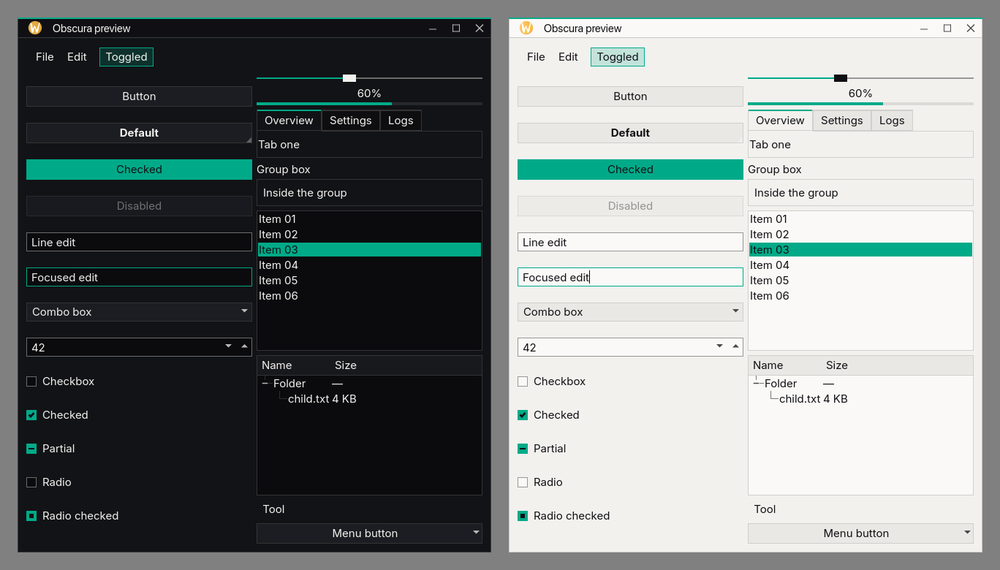
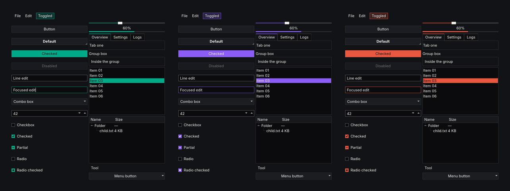
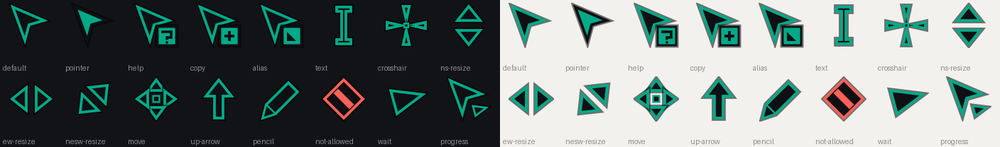
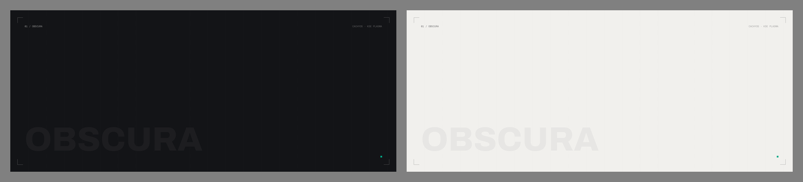

# Obscura

A sharp-cornered theme for KDE Plasma 6. Warm near-black and warm-paper surfaces, 1px hairlines,
**no rounded corners**, and one accent color that follows your System Settings accent
(CachyOS green until you pick one). Dark and light variants.



## What you get

| Layer | Notes |
|---|---|
| Color schemes | Obscura Dark, Obscura Light |
| Plasma style | panel, popups, tooltips, buttons, fields, tabs, scrollbars, switches, task buttons |
| Qt apps | a custom [Kvantum](https://github.com/tsujan/Kvantum) theme, square everywhere |
| Window decorations | Aurorae SVG: 2px accent bar on the focused window, square buttons |
| Cursors | an original set: sharp "dart" pointer, triangle resizers, accent-edged |
| Global themes + splash | one click applies everything; the splash follows the accent |
| GTK3 / GTK4 / libadwaita | squared off and tied to the live KDE palette |
| Wallpapers, Konsole schemes | dark and light |

### The accent follows you

Change **System Settings → Colors → accent color** and Plasma, Qt apps, window borders, and cursors
all follow within a few seconds. A small background service does the work for the parts that can't read
the palette themselves.



### Cursors



### Wallpapers



## Quick start

On KDE Plasma 6 (tested on CachyOS, Plasma 6.8, Wayland):

```bash
# 1. requirements (Arch / CachyOS shown; other distros: see docs/INSTALL.md)
sudo pacman -S --needed plasma-desktop breeze-gtk kvantum python-pillow pyside6 qt6-tools curl fontconfig

# 2. get it and install it (no root needed for this step)
git clone https://github.com/Obscuratea/obscura-theme.git
cd obscura-theme
./install.sh --apply
```

`--apply` switches you to Obscura Dark. Leave it off if you'd rather pick the theme yourself in
**System Settings → Appearance → Global Theme**.

New to this, or something went wrong? **[docs/INSTALL.md](docs/INSTALL.md)** has the full requirements,
a step-by-step walkthrough, and troubleshooting. To undo everything: `./uninstall.sh`.

## Good to know

- **Tested on one setup**: CachyOS x86_64, KDE Plasma 6.8, Wayland. Other Plasma 6 versions and X11 should work but are untested.
  Plasma 5 is not supported.
- Installing touches only your home directory, and a snapshot of your current appearance settings is saved first so
  `./uninstall.sh` can put them back.
- Icons are Breeze (flat, and folders follow the accent). There is no custom icon set yet.
- The login screen can't be re-skinned: Plasma Login Manager's greeter is compiled in. It can take your colors,
  cursor and fonts through System Settings → Login Screen.
- Kirigami's round user avatar and a few Plasma internals keep their own shape.

## Developing

[docs/DEVELOPING.md](docs/DEVELOPING.md) explains how the generators work, the preview harness, and the gotchas
found along the way. Pull requests are welcome.

## Credits and license

The design is inspired by the visual language of [getartcraft.com](https://getartcraft.com): warm neutrals, hairlines,
square geometry, mono numbering. This project is an independent fan theme, not affiliated with or endorsed by them,
and contains none of their assets.

Code and generated artwork: [MIT](LICENSE). The installer downloads
[Archivo](https://fonts.google.com/specimen/Archivo), [Inter](https://rsms.me/inter/),
[Geist Mono](https://vercel.com/font) and [Instrument Serif](https://fonts.google.com/specimen/Instrument+Serif)
from the google/fonts repository; they are separate works under the SIL Open Font License.
Kvantum is by Pedram Pourang (tsujan), GPL.
